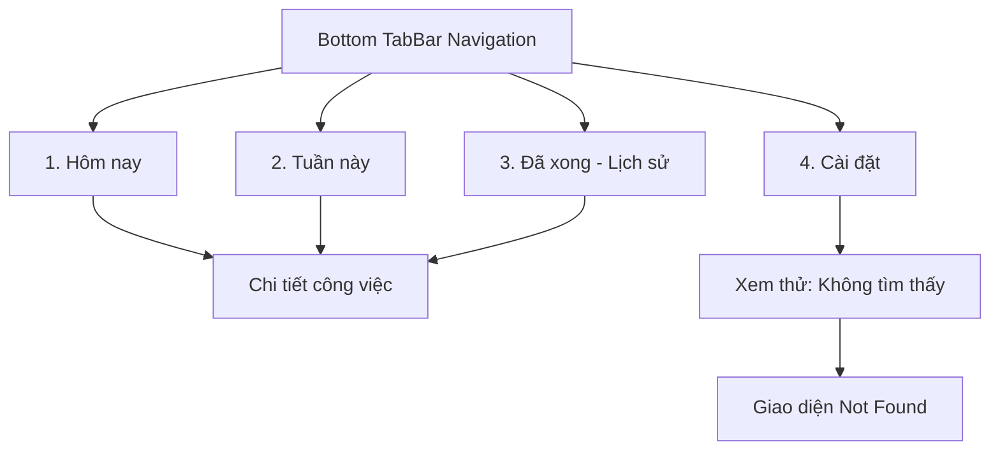

# TÀI LIỆU QUY TẮC NGHIỆP VỤ (BUSINESS.MD)

Tài liệu định nghĩa toàn bộ quy tắc nghiệp vụ, các giả định thiết kế và 5 điểm tự quyết của ứng dụng **"Việc của tôi" (MyTasksApp)** dựa trên bộ thiết kế giao diện thực tế tại `ui_design/`.

---

## 1. Năm Điểm Tự Quyết (5 Self-Determined Decisions)

Ứng dụng tuân thủ nghiêm ngặt 5 quyết định đã thống nhất để đảm bảo tính nhất quán:

| STT | Điểm tự quyết | Lựa chọn thực thi | Lý do & Ý nghĩa nghiệp vụ |
|---|---|---|---|
| **1** | **Nhóm "Xong" (Màn 1)** | Chỉ hiển thị các công việc có hạn chót trong ngày hôm nay đã hoàn thành, hoặc các việc vừa được đánh dấu hoàn thành trong phiên làm việc hôm nay. Toàn bộ việc hoàn thành trong quá khứ được quản lý tập trung tại **Tab "Đã xong" (Lịch sử)**. | Giúp người dùng tập trung tuyệt đối vào kết quả và năng suất của ngày hiện tại, tránh làm tràn màn hình bởi danh sách việc cũ từ quá khứ. |
| **2** | **Ngày bắt đầu tuần (Màn 2)** | Bắt đầu từ **Thứ Hai** và kết thúc vào **Chủ Nhật** (chuẩn ISO 8601). | Phù hợp với văn hóa làm việc và lịch công tác thực tế của người dùng và doanh nghiệp tại Việt Nam. |
| **3** | **Trạng thái ngày chọn (Màn 2)** | **Giữ nguyên ngày đã chọn** khi người dùng chuyển tab và quay lại màn hình Tuần này. | Tránh ngắt quãng luồng tư duy; người dùng không bị mất ngữ cảnh ngày đang kiểm tra khi tạm thời chuyển sang tab khác. |
| **4** | **Phạm vi chỉnh sửa & Tạo mới** | **Cho phép chỉnh sửa toàn diện:** Tiêu đề, Mô tả, Ghi chú, Hạn chót (ngày/giờ), Trạng thái tại trang Chi tiết; đồng thời cho phép tạo nhanh công việc mới qua nút **FAB (+)** lưu vào bộ dữ liệu in-memory. | Gia tăng tính tương tác, biến ứng dụng thành công cụ quản lý công việc hoàn chỉnh và chứng minh năng lực xử lý form, binding 2 chiều (Two-way binding). |
| **5** | **Tính bền vững của dữ liệu** | **Phân tầng:** - **Cài đặt** (Theme, Cỡ chữ, Ngôn ngữ): Lưu bền vững qua `Preferences`. - **Dữ liệu công việc**: Lưu In-memory (tự reset về mock data chuẩn khi khởi động lại, kèm nút "Đặt lại dữ liệu mẫu" trong phần Reviewer Tools). | Đảm bảo trải nghiệm cá nhân hóa không bị mất, đồng thời cung cấp môi trường kiểm thử an toàn, sạch sẽ, dễ dàng lặp lại cho Reviewer. |

---

## 2. Mô Hình Trạng Thái Công Việc (Task Status Workflow)

Ứng dụng hỗ trợ **3 trạng thái công việc chuẩn hóa** (theo `bottom_sheet_change_status.png`):

1. **Chưa hoàn thành (`Pending`):** Công việc chưa được thực hiện. Biểu tượng: Vòng tròn rỗng xám/xanh.
2. **Đang thực hiện (`InProgress`):** Công việc đang được xử lý. Biểu tượng: Chấm tròn màu cam (`Warning`).
3. **Đã hoàn thành (`Completed`):** Công việc đã hoàn tất. Biểu tượng: Vòng tròn xanh lá kèm dấu tích trắng (`Success`).

### Cơ chế tương tác & Chuyển đổi trạng thái:
- **Tại danh sách (Màn Hôm nay, Tuần này):**
  - Chạm vào checkbox tròn: Chuyển đổi nhanh giữa `Chưa hoàn thành` ↔ `Đã hoàn thành`.
  - Vuốt thẻ việc (SwipeView): Vuốt từ phải sang trái để bấm hoàn thành nhanh.
- **Tại màn Chi tiết công việc:**
  - Chạm vào thẻ / badge trạng thái: Mở **Bottom Sheet "Chọn trạng thái"** (`bottom_sheet_change_status.png`) cho phép chọn chính xác 1 trong 3 trạng thái.
  - Bấm nút CTA dưới cùng:
    - Nếu việc chưa xong: Nút màu `Primary` — *"Hoàn thành công việc"*.
    - Nếu việc đã hoàn thành: Nút Outlined — *"Mở lại công việc"*. Bắt buộc mở **Hộp thoại xác nhận (Confirmation Dialog)** trước khi chuyển trạng thái về `Chưa hoàn thành`.

---

## 3. Quy Tắc Nghiệp Vụ Theo Từng Màn Hình

Ứng dụng gồm **4 Tab chính** trên thanh điều hướng đáy (Bottom TabBar) và **1 Trang con điều hướng (TaskDetailPage)**:
1. **Hôm nay** (Home Tab)
2. **Tuần này** (Week Tab)
3. **Đã xong** (History Tab)
4. **Cài đặt** (Settings Tab)
- **Chi tiết công việc** (TaskDetailPage — Mở từ bất kỳ thẻ công việc nào).

---

### 3.1. Màn hình 1 — Hôm nay (Today)
*(Tham chiếu thiết kế: `01.home_screen.png`, `snack_bar.png`)*

* **Header:**
  - Hiển thị ngày tháng hiện tại (ví dụ: *"Thứ Sáu, 20 tháng 11"*).
  - Tiêu đề lớn: *"Hôm nay"*.
  - Câu chào truyền cảm hứng: *"Cố lên! Bạn đã làm rất tốt rồi! 💙"*.
  - *(Lược bỏ Avatar và Chuông thông báo để tối giản và bám sát phạm vi ASSIGNMENT.md).*
* **Thẻ Tiến độ hôm nay (Progress Card):**
  - Sử dụng dạng **Thanh tiến độ ngang (Linear Progress Bar)** đồng bộ.
  - Hiển thị tỷ lệ phần trăm (ví dụ: `65%`) và tỷ số công việc: `5/8 công việc hoàn thành`.
  - Tự động tính toán lại ngay khi trạng thái bất kỳ công việc nào trong ngày thay đổi.
* **Cấu trúc 3 nhóm công việc:**
  1. **QUÁ HẠN (Overdue):** Các việc chưa hoàn thành có hạn trước hôm nay (`DueDate < Today && Status != Completed`). Tiêu đề màu đỏ kèm chấm tròn đỏ. Badge hạn chót hiển thị số ngày quá hạn (ví dụ: *"Quá hạn 1 ngày"*).
  2. **HÔM NAY (Due Today):** Các việc chưa hoàn thành có hạn là hôm nay (`DueDate == Today && Status != Completed`). Tiêu đề màu cam kèm chấm tròn cam. Badge hiển thị giờ hoàn thành (ví dụ: *"09:30 hôm nay"*).
  3. **XONG (Completed):** Các việc có hạn hôm nay đã hoàn thành, hoặc vừa hoàn thành trong ngày. Tiêu đề màu xanh kèm chấm tròn xanh. Tiêu đề công việc được gạch ngang (`Strikethrough`).
* **Nút Tạo việc mới (FAB `+`):**
  - Nút tròn nổi góc dưới bên phải màn hình.
  - Chạm vào mở modal tạo nhanh công việc (nhập tên, mô tả, chọn hạn chót).
* **Trạng thái hệ thống:**
  - **Loading:** Hiển thị danh sách Skeleton Shimmer Cards.
  - **Empty:** Khi không còn việc nào, hiển thị thông điệp tích cực và icon hoàn tất.

---

### 3.2. Màn hình 2 — Tuần này (This Week)
*(Tham chiếu thiết kế: `02.week_screen.png`)*

* **Header & Bộ chuyển tuần:**
  - Tiêu đề: *"Tuần này"* kèm chú thích *"Theo dõi kế hoạch và tiến độ của bạn"*.
  - Thanh chuyển tuần: Nút điều hướng `<` và `>` kèm nhãn dải ngày (ví dụ: *"16 – 22 Tháng 11, 2026"*).
* **Dải chọn 7 ngày ngang (Week Strip):**
  - 7 cột đại diện từ Thứ Hai (`T2`) đến Chủ Nhật (`CN`).
  - Mỗi cột hiển thị: Thứ, Ngày trong tháng, và **chấm tròn kèm số lượng việc** của ngày đó (ví dụ: `• 4`).
  - **Ngày hôm nay:** Được phân biệt bằng đường viền nổi bật.
  - **Ngày đang chọn (Selected):** Nền đặc màu `Primary`, chữ trắng tương phản cao.
  - Chuyển tab quay lại vẫn **bảo toàn ngày đã chọn** (Điểm tự quyết 3).
* **Thẻ tóm tắt tiến độ ngày (Day Summary Card):**
  - Hiển thị thứ, ngày tháng của ngày đang chọn (ví dụ: *"Thứ Sáu, 20 tháng 11"*).
  - Tóm tắt: *"4 công việc • 2/4 hoàn thành"*.
  - Thanh tiến độ ngang (Linear Progress Bar) hiển thị tỷ lệ hoàn thành của ngày đó (ví dụ: `50%`).
* **Danh sách việc của ngày được chọn:**
  - Hiển thị danh sách công việc có `DueDate` trùng với ngày đang chọn, sắp xếp theo thời gian (`DueTime`).
  - Cho phép tích hoàn thành hoặc vuốt để hoàn thành.
* **Nút FAB `+`:** Cho phép tạo nhanh công việc với ngày hạn mặc định là ngày đang chọn.

---

### 3.3. Màn hình 3 — Chi tiết công việc (Task Detail)
*(Tham chiếu thiết kế: `detail_task.png`, `bottom_sheet_change_status.png`, `bottom_sheet_date_picker.png`, `bottom_sheet_time_picker.png`, `popup_edit_text.png`)*

* **Thông tin hiển thị:**
  - Thanh tiêu đề trang: Nút quay lại `< Chi tiết công việc`, nút menu 3 chấm `⋮`.
  - Tiêu đề công việc lớn, Tag Dự án, Chip Trạng thái hiện tại.
  - **Khối Mô tả công việc:** Hộp văn bản hiển thị mô tả chi tiết.
  - **Khối Thông tin công việc:**
    - Hạn hoàn thành (Ngày: `dd/MM/yyyy`) — Chạm vào mở `bottom_sheet_date_picker`.
    - Thời gian (Giờ: `HH:mm`) — Chạm vào mở `bottom_sheet_time_picker`.
    - Dự án: Tên dự án sở hữu việc.
    - Trạng thái: Chạm vào mở `bottom_sheet_change_status`.
  - **Khối Ghi chú:** Hiển thị nội dung ghi chú bổ sung kèm icon sổ tay màu cam.
* **Hành vi Chỉnh sửa (Edit Flow):**
  - Từ menu 3 chấm `⋮` chọn *"Chỉnh sửa thông tin"*: Mở modal `popup_edit_text.png` cho phép cập nhật Tên (max 100 ký tự), Mô tả (max 1000 ký tự), Ghi chú (max 500 ký tự) có bộ đếm ký tự trực quan.
* **Hành vi Xóa công việc:**
  - Từ menu 3 chấm `⋮` chọn *"Xóa công việc"*: Xóa việc khỏi danh sách, điều hướng quay lại trang trước, và hiển thị **Snackbar "Đã xóa công việc" kèm nút "Hoàn tác"**.
* **Thao tác Trạng thái:**
  - **Hoàn thành:** Bấm nút Solid Primary *"Hoàn thành công việc"* -> Chuyển trạng thái sang `Completed`, ghi nhận thời gian hoàn thành.
  - **Mở lại (Reopen):** Khi việc đã hoàn thành, bấm nút Outlined *"Mở lại công việc"*.
    - **Hộp thoại xác nhận bắt buộc (Confirmation Dialog):**
      - Tiêu đề: *"Mở lại công việc?"*
      - Nội dung: *"Bạn có chắc chắn muốn mở lại công việc này không? Trạng thái sẽ được chuyển về Chưa hoàn thành."*
      - Nút: *"Hủy"* và *"Xác nhận"*.
* **Xử lý Not Found:**
  - Khi mở với ID không hợp lệ hoặc kích hoạt từ nút "Xem thử" trong Cài đặt:
  - Hiển thị giao diện cảnh báo rõ ràng: Icon minh họa `DocumentError`, Tiêu đề *"Không tìm thấy công việc"*, Mô tả *"Công việc này không tồn tại hoặc đã bị xóa"*, kèm nút CTA *"Quay lại danh sách"*.

---

### 3.4. Màn hình 4 — Đã xong / Lịch sử (Completed / History Tab)
*(Tham chiếu thiết kế: `03.history_screen.png`)*

* **Mục đích:** Quản lý tập trung toàn bộ các công việc đã hoàn tất, cung cấp cái nhìn tổng quan về thành quả công việc và năng suất.
* **Header:**
  - Tiêu đề lớn: *"Lịch sử"*.
  - Phụ đề: *"Những công việc bạn đã hoàn thành"*.
* **Thẻ Thống kê thành tích (Achievement Summary Card):**
  - Icon tích xanh trong vòng tròn nổi bật.
  - Số lượng lớn: Hiển thị tổng số công việc đã hoàn thành theo bộ lọc hiện tại (ví dụ: *"24 Công việc đã hoàn thành / Trong tháng 11, 2026"*).
* **Ô Tìm kiếm trực tiếp (Real-time Search Bar):**
  - Hộp nhập liệu có icon kính lúp: *"Tìm kiếm công việc đã hoàn thành..."*.
  - Lọc tức thì danh sách hiển thị theo tiêu đề công việc hoặc tên dự án.
* **Dải Chip Bộ Lọc Thời Gian (Filter Chips):**
  - Gồm 4 mức: `Tất cả` (mặc định), `Hôm nay`, `Tuần này`, `Tháng này`.
  - Chạm vào chip nào thì danh sách và thẻ thống kê tự động cập nhật tương ứng.
* **Phân nhóm theo ngày hoàn thành:**
  - Danh sách công việc tự động gom nhóm theo ngày hoàn thành:
    - Nhóm *"Hôm nay"* (`Today`).
    - Nhóm *"Hôm qua"* (`Yesterday`).
    - Nhóm các ngày cụ thể trước đó (ví dụ: *"Thứ Tư, 18 tháng 11"*).
  - Mỗi thẻ công việc hiển thị: Checkbox xanh lá đã tích, Tiêu đề gạch ngang, Tag dự án, Giờ hoàn thành (ví dụ: `10:30`), và mũi tên `>` mở Chi tiết việc.
* **Giao diện Danh sách trống (Empty State):**
  - Hiển thị khi chưa có việc nào hoàn thành hoặc kết quả tìm kiếm rỗng:
  - Icon bảng ghi chép `ClipboardCheck`, Tiêu đề: *"Chưa có công việc hoàn thành"*, Chú thích: *"Những công việc bạn hoàn thành sẽ xuất hiện tại đây."*, Nút CTA: *"Quay lại hôm nay"*.

---

### 3.5. Màn hình 5 — Cài đặt (Settings)
*(Tham chiếu thiết kế: `04.setting_screen.png`)*

* **Mục đích:** Cá nhân hóa ứng dụng tức thì và cung cấp bộ công cụ kiểm thử toàn diện cho Reviewer.
* **Nhóm 1 — Giao diện (Theme):**
  - Bộ chọn 2 Card trực quan có hình minh họa cửa sổ mini:
    - **Sáng (Light Mode):** Card viền tím kèm dấu tích khi chọn.
    - **Tối (Dark Mode):** Card phong cách Slate Dark.
  - Thay đổi áp dụng ngay lập tức trên toàn app qua `DynamicResource`.
* **Nhóm 2 — Cỡ chữ (Font Size):**
  - Bộ điều khiển Segmented gồm 3 nút: **Nhỏ (Small)** / **Thường (Medium - Mặc định)** / **Lớn (Large)**.
  - Cập nhật tức thì tỷ lệ font, kiểm soát ngắt dòng không làm vỡ giao diện.
* **Nhóm 3 — Ngôn ngữ (Language):**
  - Bộ chọn dạng nút có icon cờ quốc gia:
    - **Tiếng Việt 🇻🇳** (kèm dấu tích khi chọn).
    - **English 🇬🇧**.
  - Đổi toàn bộ nhãn, tiêu đề, thông điệp dialog và thông báo trên toàn app.
* **Nhóm 4 — Khối "Xem trước" (Live Preview Card):**
  - Hiển thị trực tiếp 1 thẻ công việc mẫu: *"Công việc của tôi / Hoàn thành công việc quan trọng hôm nay / Review Pull Request"*.
  - Giúp người dùng và Reviewer thấy ngay kết quả thay đổi Theme và Cỡ chữ tức thì mà không cần chuyển sang màn hình khác.
* **Nhóm 5 — Công cụ kiểm thử (Reviewer Tools):**
  - Được thiết kế thành các hàng chức năng chuyên nghiệp:
    1. **Trạng thái đang tải:** Nút *"Xem thử"* -> Kích hoạt hiển thị giao diện Shimmer Loading của danh sách.
    2. **Danh sách trống:** Nút *"Xem thử"* -> Kích hoạt hiển thị giao diện Empty State.
    3. **Không tìm thấy công việc:** Nút *"Xem thử"* -> Điều hướng sang màn Chi tiết công việc với ID rác (`id=-1`) để chứng minh xử lý Not Found.
    4. **Đặt lại dữ liệu mẫu (Reset Mock Data):** Nút *"Đặt lại"* -> Khôi phục toàn bộ dữ liệu mẫu ban đầu in-memory.
* **Nhóm 6 — Thông tin ứng dụng (App Info):**
  - Logo MyTasks, tên ứng dụng *"MyTasks — Ứng dụng quản lý công việc cá nhân"*, phiên bản `1.0.0`.

---

## 4. Hệ Thống Phản Hồi & Thông Báo (Snackbar / Toast Feedback)
*(Tham chiếu thiết kế: `snack_bar.png`)*

Ứng dụng chuẩn hóa **4 loại Snackbar nổi (Floating SnackBar)** hiển thị ở cạnh dưới màn hình:

| Loại Snackbar | Biểu tượng | Màu nhấn | Nội dung mẫu | Hành động |
|---|---|---|---|---|
| **Thành công (Success)** | Checkmark xanh lá | `#10B981` | *"Đã hoàn thành công việc"* | Nút đóng `✕` |
| **Lỗi hệ thống (Danger)** | Dấu chấm than đỏ | `#EF4444` | *"Không thể cập nhật công việc"* | Nút đóng `✕` |
| **Cảnh báo (Warning)** | Tam giác cảnh báo vàng | `#F59E0B` | *"Bạn có thay đổi chưa được lưu"* | Nút đóng `✕` |
| **Xóa & Hoàn tác (Undo)** | Thùng rác xám/trắng | `#6366F1` | *"Đã xóa công việc"* | Nút *"Hoàn tác"* + Nút `✕` |

### Quy tắc nghiệp vụ Hoàn tác (Undo):
- Khi người dùng xóa một công việc, công việc tạm thời ẩn khỏi danh sách hiển thị và Snackbar xuất hiện trong `5000ms`.
- Nếu người dùng bấm **"Hoàn tác"**: Hủy lệnh xóa, công việc lập tức phục hồi về vị trí cũ trên danh sách.
- Nếu hết thời gian hoặc bấm `✕`: Xác nhận xóa vĩnh viễn khỏi bộ dữ liệu in-memory.

---

## 5. Cơ Chế Quản Lý State & Đồng Bộ Dữ Liệu

1. **Single Source of Truth:**  
   `ITaskService` được đăng ký dạng Singleton trong Dependency Injection container (`MauiProgram.cs`). Mọi màn hình (Hôm nay, Tuần này, Đã xong, Chi tiết) đều truy xuất và thao tác trên cùng một nguồn dữ liệu in-memory này.
2. **Sự kiện Đồng bộ Đa màn hình (`TaskChanged`):**  
   Khi có bất kỳ thay đổi nào (Thêm việc mới, Hoàn thành việc, Mở lại việc, Đổi trạng thái, Chỉnh sửa nội dung, Xóa việc, Hoàn tác xóa), `ITaskService` phát ra sự kiện `TaskChanged(TaskChangedEventArgs e)`.  
   Các ViewModel (`TodayViewModel`, `WeekViewModel`, `HistoryViewModel`, `TaskDetailViewModel`) lắng nghe sự kiện này và tự động refresh lại danh sách/tiến độ mà không cần reload toàn bộ trang.
3. **Tuân thủ quy tắc Agent & Đề bài:**  
   Toàn bộ mã nguồn sử dụng C# thuần và .NET MAUI Controls tiêu chuẩn, phân tầng Clean Architecture rõ ràng, không phụ thuộc thư viện bên ngoài không cần thiết.
