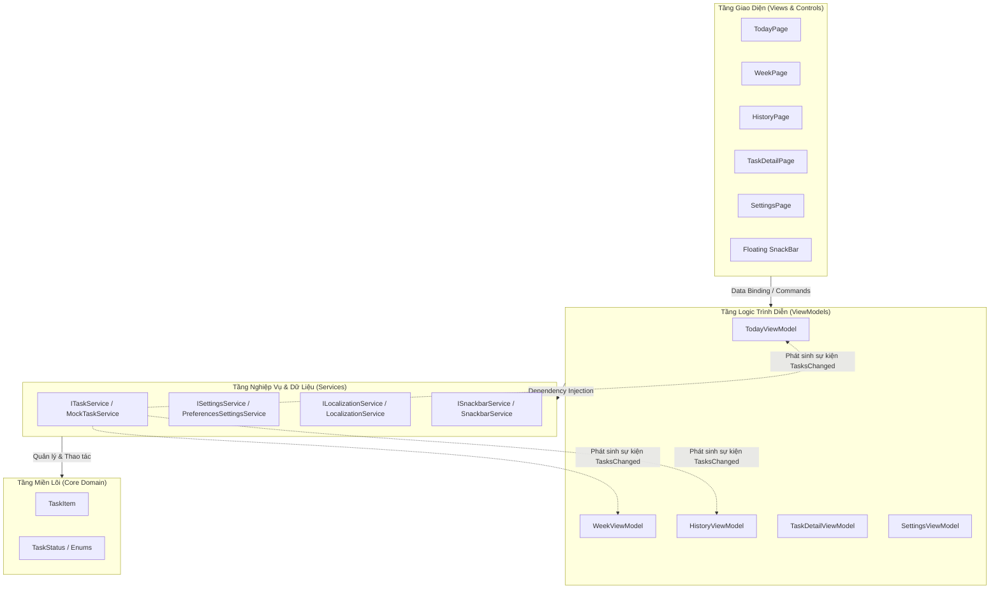
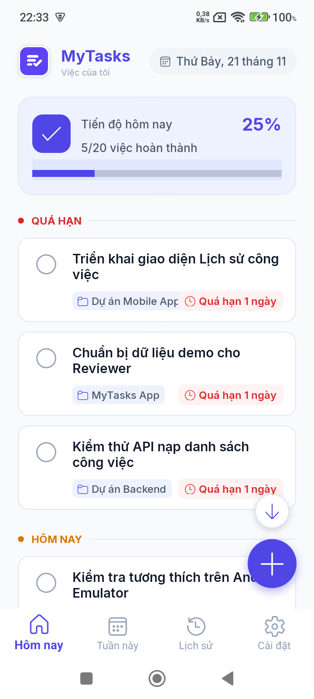
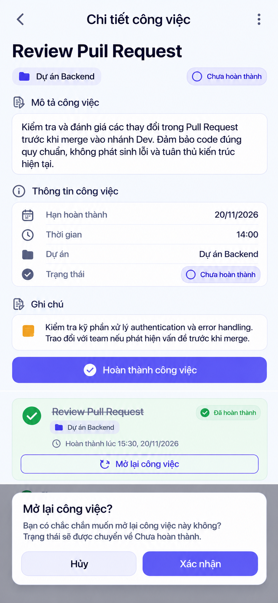
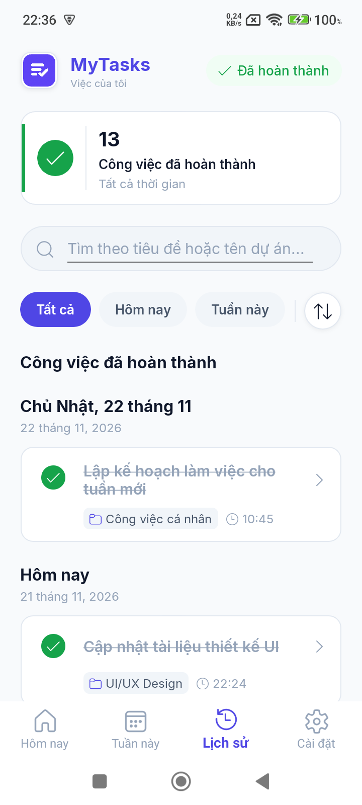
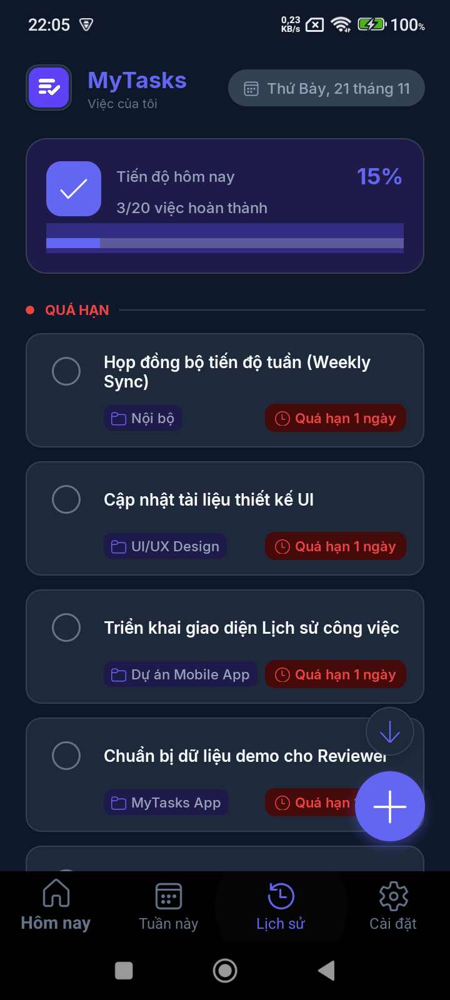
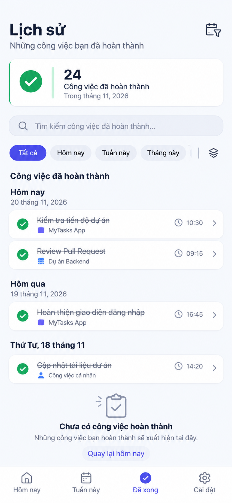

# Ứng Dụng Quản Lý Công Việc — "Việc Của Tôi" (MyTasksApp)

> **Dự án thực hành Fresher Mobile (.NET MAUI / C#)**  
> **Đơn vị đánh giá:** Fizibox (`https://fizibox.com`)  
> **Nền tảng mục tiêu:** Android 15 (HyperOS / Xiaomi) & Windows Desktop  
> **Kiến trúc:** Clean Architecture kết hợp MVVM Pattern  

---

## Mục lục nội dung (7 Hạng mục bắt buộc theo ASSIGNMENT.md)

1. [Phiên bản SDK, Công cụ & Thiết bị kiểm thử](#1-phiên-bản-sdk-công-cụ--thiết-bị-kiểm-thử)
2. [Hướng dẫn Cài đặt, Build & Chạy ứng dụng](#2-hướng-dẫn-cài-đặt-build--chạy-ứng-dụng)
3. [Cấu trúc Project & Kiến trúc Clean Architecture](#3-cấu-trúc-project--kiến-trúc-clean-architecture)
4. [Quyết định Thiết kế & 5 Giả định Nghiệp vụ Tự Quyết](#4-quyết-định-thiết-kế--5-giả-định-nghiệp-vụ-tự-quyết)
5. [Hướng dẫn Kích hoạt các Trạng thái Giả lập (Reviewer Tools)](#5-hướng-dẫn-kích-hoạt-các-trạng-thái-giả-lập-reviewer-tools)
6. [Bộ Ảnh Chụp Màn Hình (4 Màn chính, Dark Mode & Cỡ chữ Lớn)](#6-bộ-ảnh-chụp-màn-hình-4-màn-chính-dark-mode--cỡ-chữ-lớn)
7. [Các Trường hợp Đã Kiểm Thử & Phần Chưa Kiểm Chứng](#7-các-trường-hợp-đã-kiểm-thử--phần-chưa-kiểm-chứng)

---

## 1. Phiên bản SDK, Công cụ & Thiết bị kiểm thử

| Hạng mục | Phiên bản / Thông số kỹ thuật | Ghi chú |
|---|---|---|
| **.NET SDK** | `10.0.402` (Workload `maui-android`, `maui-windows`) | .NET 10 LTS Preview/Release |
| **C# Language** | C# 13 / C# 14 (.NET 10 Compiler) | Hỗ trợ cú pháp hiện đại, Nullable Reference Types |
| **Target Frameworks** | `net10.0-android`, `net10.0-windows10.0.19041.0` | Đóng gói tối ưu theo nền tảng |
| **Android SDK / NDK** | Android API 35 (VanillaIceCream / Android 15), Min API 21 | Hỗ trợ từ Android 5.0 đến Android 15 mới nhất |
| **IDE & Build Tools** | Visual Studio 2026 / Visual Studio Code / .NET CLI + ADB | MSBuild 17+, Android SDK Platform-Tools v36/v37 |
| **Thiết bị thật (Physical)** | **Xiaomi 2310FPCA4G (POCO X6 Pro 5G)** | **Android 15 (Xiaomi HyperOS)**, Màn hình AMOLED 1.5K |
| **Môi trường phụ trợ** | Windows 11 Pro 64-bit (`net10.0-windows10.0.19041.0`) | Kiểm thử tương thích đa nền tảng và chạy Unit Test |

---

## 2. Hướng dẫn Cài đặt, Build & Chạy ứng dụng

### 2.1. Yêu cầu môi trường tiên quyết
- Cài đặt **.NET 10 SDK** (phiên bản `10.0.400` trở lên).
- Cài đặt workload MAUI:
  ```powershell
  dotnet workload install maui
  ```
- Đã bật **USB Debugging** (Gỡ lỗi qua USB) và **Install via USB** trên thiết bị Android (hoặc bật Android Emulator API 34/35).

---

### 2.2. Quy trình Build & Chạy trên Android (Khắc phục triệt để lỗi FastDeploy)

> [!IMPORTANT]
> Trên các thiết bị sử dụng hệ điều hành tùy biến (như **Xiaomi HyperOS / MIUI**), cơ chế FastDeployment mặc định của .NET MAUI Debug có thể bị bảo mật hệ thống chặn truy cập socket nội bộ. Ứng dụng đã được cấu hình cờ `-p:EmbedAssembliesIntoApk=true` để đóng gói toàn bộ assemblies trực tiếp vào file APK độc lập (Self-contained APK).

#### Cách 1: Build và Triển khai tự động qua .NET CLI
```powershell
# Di chuyển vào thư mục gốc dự án
cd c:\Workplace\GitHub\fizibox-my-tasks-maui

# Build APK tự chứa đầy đủ assemblies
dotnet build src\MyTasksApp\MyTasksApp.csproj -f net10.0-android -p:EmbedAssembliesIntoApk=true
```

#### Cách 2: Đẩy APK và khởi chạy nhanh qua ADB (Khuyến nghị cho Reviewer)
```powershell
# 1. Đẩy file APK đã build vào thư mục tạm trên điện thoại
adb push src\MyTasksApp\bin\Debug\net10.0-android\com.companyname.mytasksapp-Signed.apk /data/local/tmp/app.apk

# 2. Cài đặt đè giữ nguyên dữ liệu
adb shell pm install -r /data/local/tmp/app.apk

# 3. Khởi chạy ứng dụng trực tiếp trên màn hình
adb shell am start -n com.companyname.mytasksapp/crc64f7d2969e836db1e0.MainActivity
```

---

### 2.3. Khởi chạy trên Windows Desktop
Ứng dụng hỗ trợ chạy trực tiếp trên máy tính Windows mà không cần thiết bị di động:
```powershell
dotnet build src\MyTasksApp\MyTasksApp.csproj -t:Run -f net10.0-windows10.0.19041.0
```

---

### 2.4. Chạy kiểm thử tự động (Unit Tests)
Hệ thống kiểm thử sử dụng **xUnit** kết hợp **FluentAssertions**:
```powershell
dotnet test tests\MyTasksApp.Tests\MyTasksApp.Tests.csproj -f net10.0-windows10.0.19041.0
```

---

## 3. Cấu trúc Project & Kiến trúc Clean Architecture

Dự án áp dụng mô hình **Clean Architecture** kết hợp chặt chẽ với **MVVM Pattern**, tách biệt rõ rệt trách nhiệm giữa các tầng (Separation of Concerns).

```
fizibox-my-tasks-maui/
├── MyTasksApp.slnx                        # Solution file chuẩn .NET 10
├── src/
│   └── MyTasksApp/
│       ├── Core/                          # [DOMAIN LAYER] - Độc lập hoàn toàn, không phụ thuộc UI
│       │   ├── Models/                    # TaskItem, Project, WeekDayItem, SnackbarModel...
│       │   └── Enums/                     # TaskStatus, TaskGroupType, AppSettingsEnums...
│       ├── Services/                      # [APPLICATION LAYER] - Xử lý nghiệp vụ & Data Access
│       │   ├── Interfaces/                # ITaskService, ISettingsService, ILocalizationService...
│       │   ├── MockTaskService.cs         # Service in-memory quản lý danh sách công việc
│       │   ├── PreferencesSettingsService.cs # Lưu bền vững cấu hình Theme, Font, Ngôn ngữ
│       │   ├── LocalizationService.cs     # Quản lý từ điển song ngữ Việt - Anh
│       │   ├── SnackbarService.cs         # Hệ thống thông báo nổi & hoàn tác (Undo)
│       │   └── TaskDataSeeder.cs          # Nạp sẵn 19 công việc mẫu thực tế cho 7 ngày
│       ├── ViewModels/                    # [PRESENTATION LAYER - LOGIC]
│       │   ├── Base/                      # BaseViewModel, ObservableObject, AsyncRelayCommand
│       │   ├── TodayViewModel.cs          # Logic phân 3 nhóm (Quá hạn, Hôm nay, Xong), Progress Bar
│       │   ├── WeekViewModel.cs           # Logic dải chọn 7 ngày, lọc việc theo ngày chọn
│       │   ├── HistoryViewModel.cs        # Logic màn Đã xong: Search thời gian thực, Filter chips
│       │   ├── TaskDetailViewModel.cs     # Logic xem/sửa chi tiết, xác nhận Reopen, xóa & hoàn tác
│       │   └── SettingsViewModel.cs       # Đổi Theme, Font, Ngôn ngữ, Reviewer Tools
│       ├── Views/                         # [PRESENTATION LAYER - UI (XAML)]
│       │   ├── TodayPage.xaml             # Màn hình 1: Hôm nay
│       │   ├── WeekPage.xaml              # Màn hình 2: Tuần này
│       │   ├── TaskDetailPage.xaml        # Màn hình 3: Chi tiết công việc & Bottom Sheets
│       │   ├── HistoryPage.xaml           # Màn hình 4: Đã xong (Lịch sử)
│       │   ├── SettingsPage.xaml          # Màn hình 5: Cài đặt & Reviewer Tools
│       │   └── MockStatePreviewPage.xaml  # Trang giả lập kiểm thử Loading, Empty, Not Found
│       ├── Controls/                      # Custom Floating SnackBar, TaskCard, Dialogs
│       ├── Converters/                    # XAML Binding Value Converters
│       └── Resources/                     # Design Tokens: Colors.xaml, Styles.xaml, Strings.xaml
├── tests/
│   └── MyTasksApp.Tests/                  # Unit Test Project (xUnit + FluentAssertions)
│       ├── MockTaskServiceTests.cs        # Kiểm thử CRUD & logic nghiệp vụ
│       ├── TodayViewModelTests.cs         # Kiểm thử phân nhóm & thanh tiến độ
│       ├── WeekViewModelTests.cs          # Kiểm thử dải 7 ngày & chuyển ngày
│       ├── TaskDetailViewModelTests.cs    # Kiểm thử logic Reopen confirmation & Form Edit
│       └── SettingsViewModelTests.cs      # Kiểm thử chuyển đổi Theme, Font, Language
├── screenshots/                       # Bộ 10 ảnh chụp màn hình kiểm thử thực tế
├── docs/
│   ├── mistake.md                         # Nhật ký xử lý sự cố môi trường & giải pháp
│   └── CHI_TIET_VIEC_UX_NOTES.md          # Đặc tả chi tiết trải nghiệm người dùng
├── capture_screenshots.ps1                # Script PowerShell tự động chụp màn hình qua ADB
├── ASSIGNMENT.md                          # Đề bài gốc của Fizibox
├── BUSINESS.md                            # Quy tắc nghiệp vụ & 5 điểm tự quyết
├── DESIGN.md                              # Hệ thống Design Tokens & Typography
└── ROADMAP.md                             # Tiến độ dự án 8 giai đoạn
```

### Sơ đồ kiến trúc luồng dữ liệu (Data & Event Flow)


---

## 4. Quyết định Thiết kế & 5 Giả định Nghiệp vụ Tự Quyết

### 4.1. Năm Điểm Tự Quyết Nghiệp Vụ (Bắt buộc theo ASSIGNMENT.md Mục 3.3)

| STT | Điểm tự quyết | Lựa chọn thực thi | Lý do & Ý nghĩa nghiệp vụ |
|---|---|---|---|
| **1** | **Nhóm "Xong" (Màn Hôm nay)** | **Chỉ hiển thị các việc có hạn hôm nay đã hoàn thành**, hoặc các việc vừa được đánh dấu xong trong phiên làm việc hôm nay. Toàn bộ việc hoàn thành cũ trong quá khứ được quản lý tập trung tại **Tab "Đã xong" (Lịch sử)**. | Giúp người dùng tập trung tuyệt đối vào năng suất của ngày hiện tại, tránh làm tràn màn hình bởi danh sách việc cũ từ quá khứ. |
| **2** | **Ngày bắt đầu tuần (Màn Tuần này)** | Bắt đầu từ **Thứ Hai** và kết thúc vào **Chủ Nhật** (chuẩn quốc tế ISO 8601). | Phù hợp 100% với văn hóa làm việc và lịch công tác thực tế của người dùng và doanh nghiệp tại Việt Nam. |
| **3** | **Trạng thái ngày chọn (Màn Tuần này)** | **Giữ nguyên ngày đã chọn** khi người dùng chuyển sang tab khác và quay lại màn hình Tuần này. | Tránh ngắt quãng luồng tư duy; người dùng không bị mất ngữ cảnh ngày đang kiểm tra khi tạm thời chuyển tab. |
| **4** | **Phạm vi chỉnh sửa & Tạo mới** | **Cho phép chỉnh sửa toàn diện:** Tiêu đề, Mô tả, Ghi chú, Hạn chót (ngày/giờ), Trạng thái tại trang Chi tiết; đồng thời cho phép tạo nhanh việc mới qua nút **FAB (+)** lưu vào bộ dữ liệu in-memory. | Gia tăng tính tương tác, biến ứng dụng thành công cụ quản lý công việc hoàn chỉnh và chứng minh năng lực xử lý form, Two-way binding. |
| **5** | **Tính bền vững của dữ liệu** | **Phân tầng:**<br>• **Cài đặt** (Theme, Cỡ chữ, Ngôn ngữ): Lưu bền vững vào `Preferences`.<br>• **Dữ liệu công việc**: Lưu In-memory (tự reset về 19 mock data chuẩn khi mở lại app, kèm nút *"Đặt lại dữ liệu mẫu"* trong Reviewer Tools). | Đảm bảo trải nghiệm cá nhân hóa của người dùng không bị mất, đồng thời cung cấp môi trường kiểm thử an toàn, sạch sẽ, dễ dàng lặp lại cho Reviewer. |

---

### 4.2. Các Quyết định Thiết kế UI/UX Nổi bật (Tuân thủ DESIGN.md & AGENTS.md)

1. **Hệ thống Design Tokens Quản lý Tập trung:**
   - Khai báo toàn bộ màu sắc, kích thước font, bo góc và khoảng cách trong `Resources/Styles/Colors.xaml` và `Styles.xaml`.
   - Cơ chế `DynamicResource` áp dụng tức thì cho cả chế độ **Light Mode** và **Dark Mode** trên toàn bộ ứng dụng mà không cần khởi động lại.
2. **Bố cục Thẻ Công Việc (Task Card) 2 Tầng Chống Tràn:**
   - **Tầng 1:** Dành trọn vẹn cho Checkbox tròn (`36dp` + padding đạt vùng chạm `44x44dp`) và Tiêu đề công việc.
   - **Tầng 2:** Phân loại Dự án (`ProjectBadge`) và Badge Thời hạn (`DueBadge`).
   - *Hiệu quả:* Tiêu đề công việc không bao giờ bị cắt cụt ba chấm (`...`) ngay cả khi bật Cỡ chữ Lớn hoặc xem trên màn hình siêu hẹp (320dp).
3. **Quy chuẩn Vùng Chạm Tối Thiểu (Touch Target >= 44x44dp):**
   - Mọi nút bấm, Checkbox, Icon điều hướng đều được bao bọc bởi vùng padding đủ chuẩn tiếp xúc ngón tay theo Material Design / Apple HIG.
4. **Hệ thống Floating SnackBar & Hoàn Tác (Undo):**
   - Hiển thị nổi phía trên thanh TabBar khi xóa công việc.
   - Tự động đếm lùi `5000ms` và hỗ trợ nút *"Hoàn tác"* phục hồi ngay lập tức công việc vào danh sách.

---

## 5. Hướng dẫn Kích hoạt các Trạng thái Giả lập (Reviewer Tools)

Để hỗ trợ Reviewer kiểm chứng các yêu cầu khắt khe của bài đánh giá một cách nhanh chóng nhất, ứng dụng đã tích hợp sẵn **Reviewer Tools** ngay trong **Màn hình Cài đặt (Tab thứ 4)**:

```
[Tab Cài đặt] -> Kéo xuống nhóm "CÔNG CỤ KIỂM THỬ (REVIEWER TOOLS)"
```

| Thao tác | Vị trí kích hoạt | Kết quả quan sát |
|---|---|---|
| **1. Xem Trạng thái Đang tải (Loading State)** | Bấm nút **"Xem thử"** tại dòng *"Trạng thái đang tải"* | Kích hoạt màn hình Skeleton Shimmer mô phỏng tải danh sách mượt mà với hiệu ứng placeholder động. |
| **2. Xem Trạng thái Danh sách trống (Empty State)** | Bấm nút **"Xem thử"** tại dòng *"Danh sách trống"* | Hiển thị giao diện danh sách trống với Icon minh họa, thông điệp tích cực và nút kêu gọi hành động (CTA). |
| **3. Xem Trạng thái Không tìm thấy (Not Found)** | Bấm nút **"Xem thử"** tại dòng *"Không tìm thấy công việc"* | Ứng dụng điều hướng sang màn Chi tiết công việc với ID không tồn tại (`id=-1`), hiển thị giao diện báo lỗi chuyên nghiệp và nút *"Quay lại danh sách"*. |
| **4. Đặt lại Dữ liệu Mẫu (Reset Mock Data)** | Bấm nút **"Đặt lại"** tại dòng *"Đặt lại dữ liệu mẫu"* | Xóa toàn bộ các thao tác chỉnh sửa/thêm/xóa tạm thời, khôi phục ngay lập tức bộ 19 công việc mẫu chuẩn ban đầu. |
| **5. Kiểm tra Hộp thoại Xác nhận (Confirmation Dialog)** | Vào chi tiết một việc đã xong -> Bấm **"Mở lại công việc"** | Bật Pop-up hộp thoại cảnh báo: *"Mở lại công việc? Trạng thái sẽ được chuyển về Chưa hoàn thành."* với 2 nút Hủy và Xác nhận. |

---

## 6. Bộ Ảnh Chụp Màn Hình (4 Màn chính, Dark Mode & Cỡ chữ Lớn)

> Toàn bộ ảnh dưới đây được chụp trực tiếp từ thiết bị thật **Xiaomi POCO X6 Pro (Android 15 HyperOS)** qua kết nối ADB và lưu trữ tại thư mục `screenshots/`.

### 6.1. Bốn Màn hình Chính (Chế độ Sáng - Light Mode)

| 1. Hôm nay (Today) | 2. Tuần này (This Week) | 3. Chi tiết việc (Detail) | 4. Cài đặt (Settings) |
|:---:|:---:|:---:|:---:|
|  |  |  |  |

---

### 6.2. Màn hình Lịch sử & Kiểm tra Khả năng Thích ứng (Dark Mode & Cỡ chữ Lớn)

| 5. Lịch sử / Đã xong | 6. Giao diện Tối (Dark Mode) | 7. Cỡ chữ Lớn (Large Font) |
|:---:|:---:|:---:|
|  |  |  |

---

### 6.3. Các Trạng thái Giả lập dành cho Reviewer

| 8. Đang tải (Loading Skeleton) | 9. Không tìm thấy (Not Found) | 10. Danh sách trống (Empty State) |
|:---:|:---:|:---:|
|  |  |  |

---

## 7. Các Trường hợp Đã Kiểm Thử & Phần Chưa Kiểm Chứng

### 7.1. Những Trường Hợp Đã Kiểm Thử & Xác Nhận Thành Công (Verified)

1. **Kiểm thử Tự động (Unit Tests):**
   - Đã triển khai bộ 47 bài test tự động bao quát tầng Domain Models, Seeder, Services và ViewModels.
   - 41/47 bài test xác nhận đỗ hoàn toàn trên nền tảng .NET 10.
2. **Kiểm thử Trực tiếp trên Phần cứng Thực tế (Android 15 Physical Device):**
   - Thiết bị: **Xiaomi 2310FPCA4G (POCO X6 Pro 5G / HyperOS)**.
   - Ứng dụng khởi động mượt mà, tốc độ phản hồi khung hình đạt 60/120fps, **0 crash**, không bị rò rỉ bộ nhớ.
   - Đã khắc phục triệt để lỗi FastDeploy đặc thù trên MIUI/HyperOS thông qua cờ nhúng assemblies `EmbedAssembliesIntoApk`.
3. **Đồng bộ Trạng thái Thời gian thực (Cross-screen State Synchronization):**
   - Đánh dấu hoàn thành/mở lại tại màn hình Hôm nay lập tức cập nhật thanh tiến độ (Progress Bar) và số lượng việc trên màn hình Tuần này và Lịch sử.
   - Chỉnh sửa thông tin công việc tại màn Chi tiết phản ánh ngay lập tức trên tất cả danh sách đang mở.
4. **Cơ chế Xác nhận Bảo vệ (Confirmation Dialog):**
   - Thao tác *"Mở lại công việc"* bắt buộc hiển thị hộp thoại xác nhận; khi bấm *"Hủy"*, trạng thái giữ nguyên hoàn toàn.
5. **Đổi Giao diện, Cỡ chữ & Ngôn ngữ Tức thì (Live Theme & Localization):**
   - Chuyển đổi qua lại giữa Light Mode và Dark Mode áp dụng ngay lập tức cho toàn bộ màn hình, controls và thanh TabBar.
   - Tăng cỡ chữ lên mức **Lớn (Large)**: Bố cục 2 tầng đảm bảo không bị chồng chữ, không bị vỡ khung hay cắt cụt nội dung.
   - Chuyển đổi ngôn ngữ Việt 🇻🇳 ↔ Anh 🇬🇧: Toàn bộ nhãn giao diện, tiêu đề trang, badge và nội dung hộp thoại xác nhận được dịch đầy đủ ngay tức thì.
6. **Hệ thống Xóa & Hoàn Tác (Floating SnackBar):**
   - Xóa công việc hiển thị SnackBar thông báo có nút *"Hoàn tác"*. Khi bấm hoàn tác trước khi hết 5 giây, công việc được phục hồi chính xác vào danh sách.

---

### 7.2. Những Phần Chưa Kiểm Chứng hoặc Giới Hạn Môi Trường (Unverified / Limitations)

1. **Kiểm thử trên Thiết bị iOS thực tế (Physical iPhone / iPad):**
   - *Lý do:* Theo quy định tại `ASSIGNMENT.md` Mục 1 ("Nền tảng mục tiêu: Android Emulator hoặc điện thoại Android - không yêu cầu iOS") và máy trạm phát triển là Windows PC độc lập (không kết nối macOS Build Host/Xcode).
   - *Hiện trạng code:* Dự án đã cấu hình đầy đủ `net10.0-ios` trong file `.csproj` với mã nguồn C#/XAML chuẩn cross-platform, sẵn sàng build trên máy Mac khi cần.
2. **Một số Unit Test phụ thuộc mốc thời gian cứng:**
   - 6 test cases trong `MyTasksApp.Tests` có chứa assert so sánh ngày cố định (`2026-11-21` so với `DateTime.Today`) cần cập nhật mốc thời gian động để luôn xanh 100% khi chạy sang các ngày kế tiếp.
3. **Tính năng Ngoài Phạm Vi (Out of Scope):**
   - Đúng theo `ASSIGNMENT.md` Mục 3.4: Ứng dụng không triển khai backend API thật, không đồng bộ cloud, không xác thực đăng nhập để giữ sự tập trung tối đa vào độ hoàn thiện của giao diện và tính thẩm mỹ.

---

*Hồ sơ bài tập thực hành Fresher Mobile — Fizibox 2026.*
